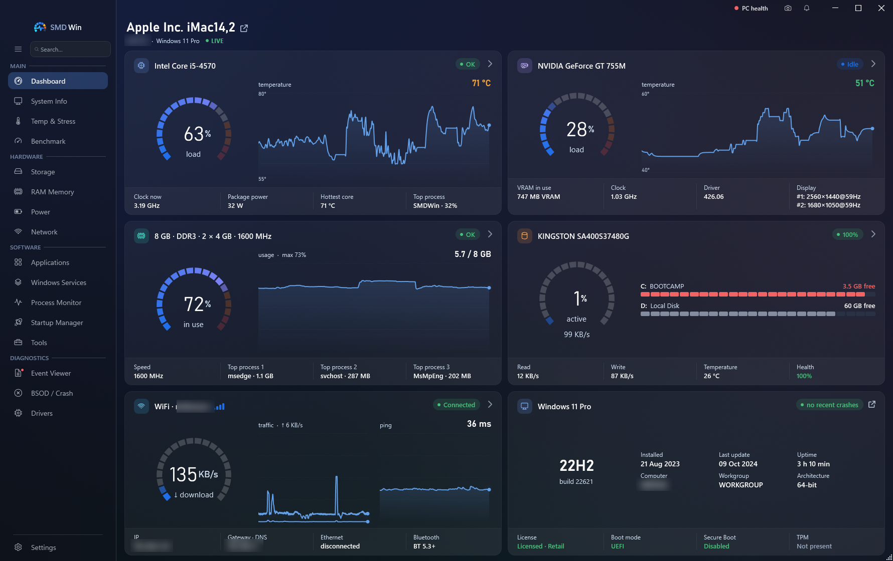
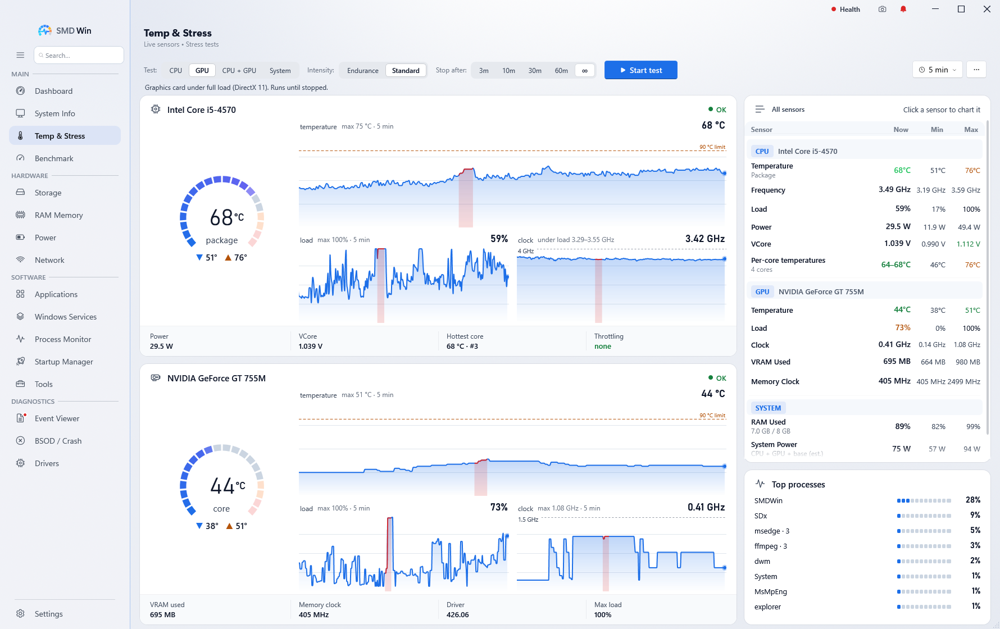
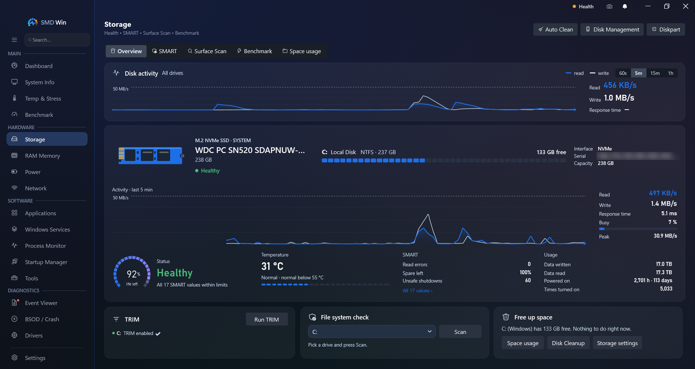

# SMD Win

**A Windows diagnostics tool for checking a PC in a few minutes: hardware, temperatures, storage health, stress tests and Windows problems, in one portable exe.**

SMD Win is made for the moment someone asks "is this computer OK?". It is started, it shows what is in the machine and how healthy it is, it runs the tests that are needed, and it can produce a report. It does not need to be installed and it does not stay in the background.

> Status: **beta**. It is tested on a limited number of machines. Bug reports with the log folder are very welcome (see [Reporting a problem](#reporting-a-problem)).



| Temp & Stress | Storage |
|---|---|
|  |  |

## What it does

**Overview**
- Dashboard with one row per component: processor, graphics, memory, storage, network, battery — current value, short history and status.
- Health check that lists real problems only (overheating, failing drive, low space, crashes, missing drivers).
- System Information on one screen, with drawings of the detected hardware, and a PDF export.

**Temperatures and stress tests**
- Live temperatures, clock speeds, power and fan speeds.
- Processor, graphics and full-system stress tests (Standard or Long), with integrity checks and automatic stop after the chosen time.
- Throttling detection with a plain explanation.
- Turbo Boost and processor boost mode, either temporary (only while SMD Win is open) or permanent.

**Benchmark**
- Marks from 0 to 10 for the processor, memory, storage and graphics card, in about 2.5 minutes, and a performance class with what the PC is suitable for.
- Checks before the test (on battery, Power saver plan, Turbo off, busy processor, free space) and short advice per component after it.
- The marks are first estimates in this beta, calibrated on a few machines; the raw values are saved in `Data\Benchmark`.

**Storage**
- SMART health for SATA, NVMe and USB drives (through smartctl), with history.
- Surface scan, benchmark (sequential, random, latency), space usage and large files.

**Memory, power, network**
- Memory modules and slots, memory tests.
- Battery health and history, power plans, sleep and wake timeline.
- Network tools: diagnosis, Wi-Fi, ping monitor, traceroute, DNS, port and LAN scanner, LAN speed, internet speed test, firewall rules.

**Windows**
- Crashes (BSOD) with likely cause, Event Viewer with explanations for common events.
- Drivers, startup apps, services, installed apps, processes.
- Optimize and Auto-Clean, with the original values saved so every change can be reverted.

**Reports**
- PDF and HTML reports, a diagnostic package, and an optional workshop name on reports for computer services.

Languages: English, Romanian, German, French.

## Requirements

- Windows 10 or Windows 11, 64-bit.
- Administrator rights (needed to read sensors, SMART data and system settings).
- No .NET installation needed: the exe is self-contained.

## Getting started

1. Download `SMDWin.exe` from [Releases](../../releases).
2. Run it. Windows asks for administrator rights.
3. On first start, SMD Win may offer to install **PawnIO**, a signed open-source driver used to read some sensors. It is optional; without it some temperatures may be missing.

Windows SmartScreen may show "Windows protected your PC" because the exe is not code-signed yet. Choose **More info → Run anyway**.

Everything SMD Win writes (settings, logs, reports) goes to a `Data` folder next to the exe, so it can run from a USB stick.

## What it changes on the PC

SMD Win changes Windows settings only when a button for that change is pressed.

| Area | What is kept so it can be undone |
|---|---|
| Optimize, services, startup apps | Original values saved; Revert restores them |
| Windows Update blocking | Original settings saved and a restore script written to `C:\ProgramData\SMDWin` (it stays on the PC, so updates can be restored even without SMD Win) |
| Turbo Boost / processor boost mode | Temporary changes are restored on close; permanent ones stay |
| Auto-Clean | Deleted files are not recoverable — the total is shown and confirmed before deleting |

## Privacy

SMD Win has no accounts, no telemetry and no ads. It connects to the internet only for these features:

| Service | When | Why |
|---|---|---|
| ipwho.is, then ipapi.co | Opening the Network page | Public IP, provider and approximate location |
| Cloudflare, OVH, testfile.org, httpbin.org | Running the speed test | Download and upload test |
| google.com, 8.8.8.8, 1.1.1.1 | Network diagnosis, ping monitor, DNS test | Checking that the internet and name resolution work |
| feodotracker.abuse.ch | Only when network alerts are turned on (off by default) | List of known dangerous addresses, compared with this PC's connections |
| api.github.com | Only when **Check for updates** is clicked in About | Latest version number (nothing is downloaded or installed by SMD Win itself) |
| github.com (PawnIO) | Installing PawnIO, only if the bundled installer is missing | Driver installer |
| A search page in the browser | Pressing "search" next to a driver, an event or an error | Opens the browser; SMD Win sends nothing itself |

Logs and reports stay on the PC. They contain details of the hardware (serial numbers, the network's name, MAC addresses, the public IP) — check them before sharing them publicly.

## Known limitations

- **Beta.** Tested on a limited number of machines; some sensors (fans, voltages, some laptops' power data) are missing on some models.
- **Benchmark marks are estimates.** They will be tuned as more results come in.
- **Not code-signed yet.** SmartScreen warns on first start, and some antivirus programs may flag an unsigned exe that asks for administrator rights and installs a sensor driver. The SHA-256 checksum of every release is published next to the exe.
- **Accessibility.** Screen-reader names and keyboard navigation are minimal.
- **Windows 11 24H2:** the `wmic` tool is gone, so a few sections of the diagnostic package can be empty.

## Building from source

Requirements: Windows, [.NET 8 SDK](https://dotnet.microsoft.com/download/dotnet/8.0).

```
build.bat      builds in Release and starts SMD Win as administrator
publish.bat    produces a single self-contained SMDWin.exe in publish\
```

Tests: `dotnet test SMDWin.Tests/SMDWin.Tests.csproj`

## Reporting a problem

Open an [issue](../../issues) and attach:
- the `Data\Logs` folder (zipped),
- the PC model and Windows version,
- a screenshot if something looks wrong.

Issues are public. The logs and self-test files contain serial numbers, the Wi-Fi network's name, MAC addresses and the public IP — remove what should not be public before attaching them.

## Credits

SMD Win is built on [LibreHardwareMonitor](https://github.com/LibreHardwareMonitor/LibreHardwareMonitor), [smartmontools](https://www.smartmontools.org/), [PawnIO](https://github.com/namazso/PawnIO), [WPF-UI](https://github.com/lepoco/wpfui) and other open-source projects. See [THIRD-PARTY-NOTICES.md](THIRD-PARTY-NOTICES.md).

## License

SMD Win is free software, released under the **GNU General Public License v3.0 or later** (GPL-3.0-or-later). It can be used, studied, shared and modified; anyone who distributes a modified version must publish its source code under the same license. Full text: [LICENSE](LICENSE).

© Paul Chirilă
